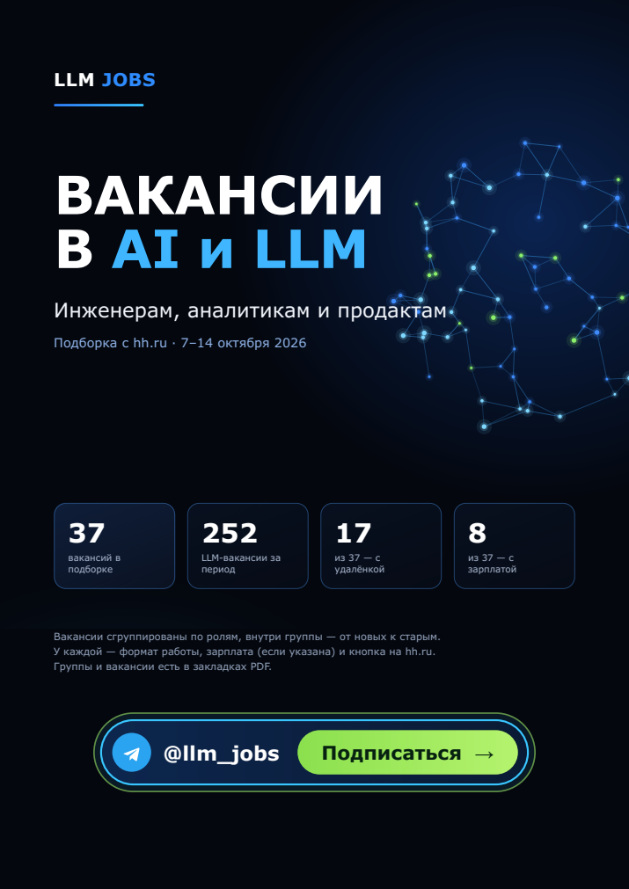
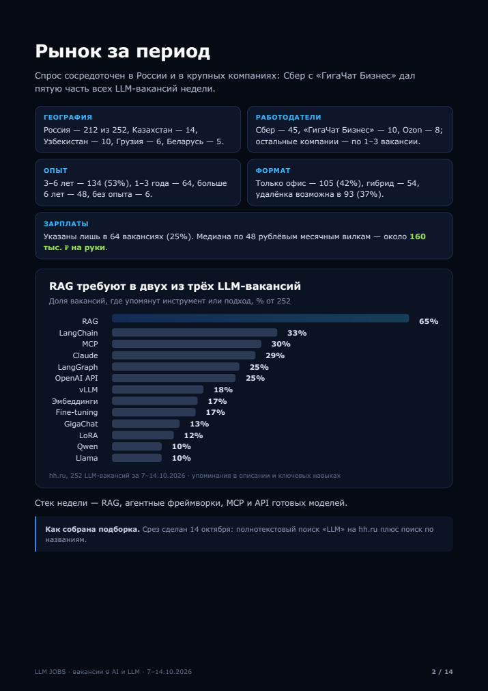
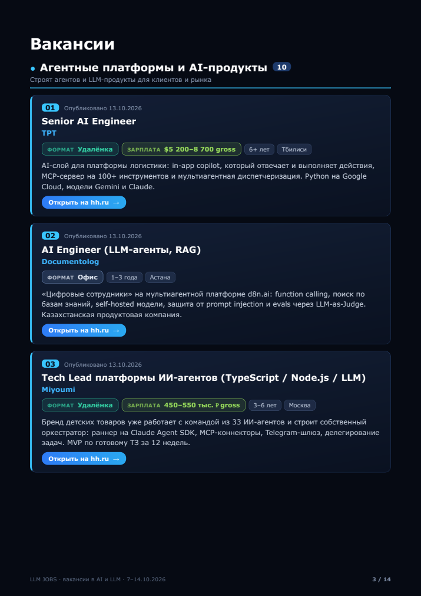

# LLM JOBS — дайджест LLM-вакансий с hh.ru

Скилл для Claude собирает LLM- и AI-вакансии с hh.ru за выбранный период и верстает из них PDF «LLM JOBS». В PDF есть обложка, сводка «Рынок за период» с графиком стека и 30–40 отобранных вакансий в 7 группах по ролям. У каждой вакансии указаны формат работы, опыт, город, зарплата, если она есть, короткий пересказ и кнопка на hh.ru.

| Обложка | Рынок за период | Вакансии |
|---|---|---|
|  |  |  |

Пример готового PDF: [`examples/LLM_JOBS_vakansii_2026-10-07_2026-10-14.pdf`](examples/LLM_JOBS_vakansii_2026-10-07_2026-10-14.pdf).

## Как пользоваться

Попросите Claude обычными словами, например:

> Собери дайджест LLM-вакансий с hh.ru за 7–14 октября

> Подборка AI-вакансий hh за последнюю неделю

Скилл сам переведёт период в окно поиска hh.ru, соберёт и отфильтрует вакансии, напишет пересказы и соберёт PDF. Неделя данных собирается примерно за полчаса, почти всё это время занимает аккуратная загрузка карточек вакансий.

## Требования

**1. Браузер, в котором Claude может выполнять JavaScript.** Это обязательное условие. Данные собираются прямо во вкладке hh.ru: поиск через WebFetch или curl не подходит, потому что hh отдаёт такой выдаче только часть карточек и показывает капчу.

| Где запускаете | Что нужно |
|---|---|
| **Claude Desktop** | Встроенный браузер или расширение Claude in Chrome |
| **Claude Code** | Браузерный MCP: [`chrome-devtools-mcp`](https://github.com/ChromeDevTools/chrome-devtools-mcp) или [Playwright MCP](https://github.com/microsoft/playwright-mcp) |
| claude.ai без браузера, Claude Code без браузерного MCP | ❌ не заработает: скилл сразу скажет, что браузера нет |

Подключить `chrome-devtools-mcp` к Claude Code можно так:

```bash
claude mcp add chrome-devtools -- npx chrome-devtools-mcp@latest
```

Если хотите работать в своём Chrome, где вы уже залогинены на hh.ru, запустите его с отладочным портом и подключите MCP к этому порту:

```bash
"/Applications/Google Chrome.app/Contents/MacOS/Google Chrome" --remote-debugging-port=9222
claude mcp add chrome-devtools -- npx chrome-devtools-mcp@latest --browser-url=http://127.0.0.1:9222
```

**2. Python 3 с WeasyPrint** нужен для сборки PDF:

```bash
pip install weasyprint pypdf
# macOS: WeasyPrint нужен Pango
brew install pango
```

Шрифт [Inter](https://rsms.me/inter/) желателен. Без него PDF соберётся со шрифтом DejaVu Sans.

## Установка

### Claude Code: как плагин

```
/plugin marketplace add axmakarov/llm-jobs-hh-digest
/plugin install llm-jobs-hh-digest@llm-jobs-hh-digest
```

### Claude Code: вручную

```bash
git clone https://github.com/axmakarov/llm-jobs-hh-digest.git
cp -r llm-jobs-hh-digest/skills/llm-jobs-hh-digest ~/.claude/skills/
```

### Claude Desktop / claude.ai

1. Скачайте `llm-jobs-hh-digest.zip` со страницы [Releases](https://github.com/axmakarov/llm-jobs-hh-digest/releases/latest).
2. В настройках Claude откройте раздел со скиллами (Settings → Capabilities), загрузите архив и включите скилл.

## Что внутри

```
skills/llm-jobs-hh-digest/
├── SKILL.md                    # инструкция для Claude
├── scripts/
│   ├── hh_llm.js               # сборщик: встраивается во вкладку hh.ru
│   ├── build_digest.py         # digest.json → PDF (WeasyPrint)
│   └── style.css               # вёрстка PDF
└── examples/digest_example.json
```

Скрипт сборки PDF можно запускать и без Claude, если `digest.json` у вас уже готов:

```bash
python3 skills/llm-jobs-hh-digest/scripts/build_digest.py \
  skills/llm-jobs-hh-digest/examples/digest_example.json out
```

## Ограничения и правила

- hh.ru ищет только за последние 1, 3, 7 или 30 дней, поэтому более старые периоды собрать нельзя.
- Сборщик работает медленно: одна вакансия раз в 1,2–2 секунды, без параллельных запросов. Если hh.ru всё же покажет капчу, Claude попросит пройти её вручную. Обходить капчу скилл не пытается.
- Вёрстка hh.ru иногда меняется, и тогда селекторы в `hh_llm.js` придётся обновить. Если что-то сломалось, заведите issue.
- Скилл рассчитан на личное использование: подготовку подборок для себя. При публикации соблюдайте пользовательское соглашение hh.ru и не используйте скилл для массовой выгрузки данных.

## Автор

Алексей Макаров — [@ax_makarov](https://t.me/ax_makarov) в Telegram.

Свежие LLM-вакансии публикуются в Telegram-канале [@llm_jobs](https://t.me/llm_jobs).

## Лицензия

[MIT](LICENSE)
